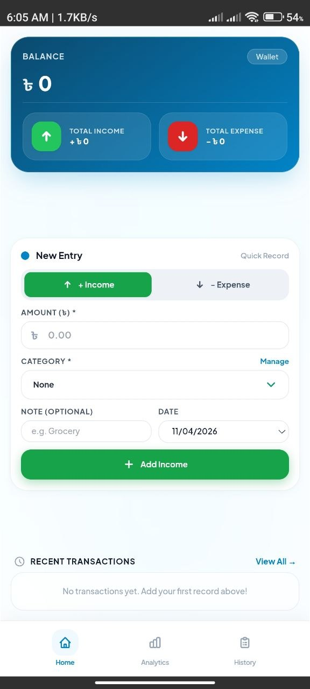
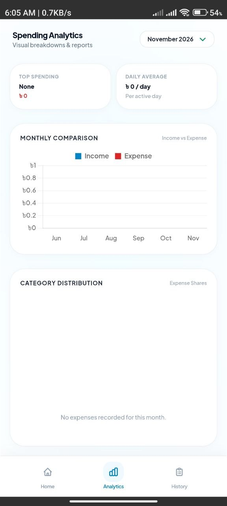
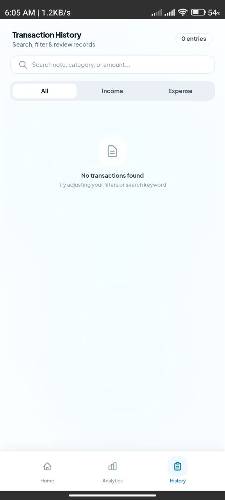
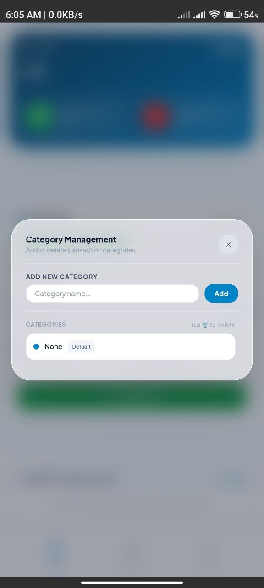

# SpendFlow

A personal finance management Android application built with an iOS Frosted Glass aesthetic, local-first data storage, and zero external runtime dependencies.

<p align="center">
  
</p>

<p align="center">
  <a href="https://github.com/n0vemberain/SpendFlow/releases/latest">
    
  </a>
  &nbsp;
  
  &nbsp;
  
</p>

---

## Application Previews

<p align="center">
  
  &nbsp;
  
  &nbsp;
  
  &nbsp;
  
</p>

---

## Architectural and Functional Overview

- **Currency Standardization**: Native support for Bangladeshi Taka (BDT) formatting with standard delimiter separation.
- **Interface Structure**: Glassmorphic styling utilizing scoped backdrop filters, translucent surface cards, and restrained visual hierarchy.
- **Transactional Categorization**:
  - Income operations are represented with vivid green (#16a34a) accents, badges, and feedback notifications.
  - Expense operations are represented with distinct red (#dc2626) accents, badges, and alerts.
- **Fixed Viewport Navigation**: Persistent three-tab structure (Home, Analytics, History) anchored to the viewport base, eliminating unwanted layout shifts.
- **Custom Selection Controls**: Replaced platform-native select popups with custom floating popover menus featuring integrated selection state indicators.
- **Temporal Input Boundaries**: Automatic pre-fill of current local device date, combined with strict validation preventing selection of future dates.
- **Privacy and Offline Operation**: Built without external CDN connections; all styling, chart engines, and persistent ledger data reside strictly on the local device.

---

## Installation

1. Navigate to the latest release on the [Releases](https://github.com/n0vemberain/SpendFlow/releases/latest) page, or download the binary directly:
   - [SpendFlow.apk](https://github.com/n0vemberain/SpendFlow/releases/download/v1.0.0/SpendFlow.apk)
2. Transfer and open the `.apk` file on an Android device running Android 7.0 (API level 24) or higher.
3. If prompted by system security settings, enable installation from unknown sources.
4. Complete the package installer prompt to finalize installation.

---

## Technology Stack

- **Core Runtime**: Vanilla HTML5, modern ECMAScript (ES6+).
- **Styling Architecture**: Tailwind CSS (locally compiled and bundled).
- **Visualization Engine**: Chart.js (offline bundled).
- **Native Bridge**: Capacitor for Android.
- **Target Platform**: Android API 24 through API 36.

---

## Source and Build Instructions

To build the application package locally:

```bash
# Clone the repository
git clone https://github.com/n0vemberain/SpendFlow.git
cd SpendFlow

# Install dependencies
npm install

# Sync web assets to Android platform
npx cap sync android

# Build debug APK using Gradle wrapper
cd android
./gradlew assembleDebug
```

The compiled APK will be generated at:
`android/app/build/outputs/apk/debug/app-debug.apk`

---

## License

This project is licensed under the terms of the ISC License.
